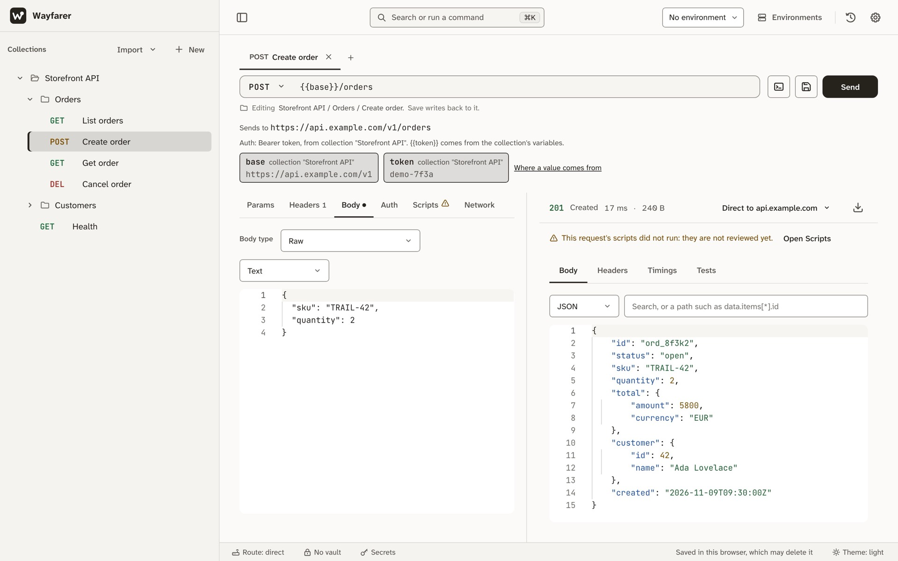

<p align="center">
  <picture>
    <source media="(prefers-color-scheme: dark)" srcset="packages/tokens/brand/wordmark-dark.svg">
    
  </picture>
</p>

<p align="center">
  <strong>The API client that opens in a tab.</strong><br>
  No account, no install, no server of ours: your requests, collections and secrets stay in your browser.
</p>

<div align="center">

[Open Wayfarer](https://wayfarer.ashwinsathian.com/app/) · [Getting started](docs/getting-started.md) · [Compared with others](https://wayfarer.ashwinsathian.com/compare/) · [Tested claims](docs/claims.md) · [Changelog](CHANGELOG.md)

[](https://github.com/AshwinSathian/wayfarer/actions/workflows/ci.yml)
[](https://github.com/AshwinSathian/wayfarer/releases/latest)
[](https://www.npmjs.com/package/wayfarer-cli)
[](https://www.npmjs.com/package/wayfarer-bridge)
[](LICENSE)

</div>

<picture>
  <source media="(prefers-color-scheme: dark)" srcset="docs/images/app-dark.jpg">
  
</picture>

## Why Wayfarer

- **It opens in a tab.** Nothing to install and no account to make. After one visit it loads offline, and it installs as an app.
- **Nothing leaves but your request.** No telemetry and no server of ours: the only traffic is the request you send, to the host you chose.
- **Your Postman work comes with you.** Import Postman, Insomnia, OpenAPI, HAR or a cURL command. Postman scripts run in a QuickJS sandbox and give the test results Newman gives.
- **Secrets stay secret.** The vault encrypts each value (PBKDF2-SHA-256 at 600,000 iterations, AES-GCM-256), and history, exports and shared files hold none of them.
- **Share without a server.** Send a collection as an encrypted link: the content and its key sit after the `#`, which the browser never sends.
- **More than REST.** GraphQL with the server's schema, WebSockets, event streams, collection runs with data files, and tabs that survive a reload.
- **Command line and CI.** `npx wayfarer-cli run collection.json` runs a collection with the app's engine and gives its results.
- **When the browser says no,** `npx wayfarer-bridge` sends the request from your machine, past CORS, forbidden headers and mixed content.
- **Every claim is tested.** Each line under [All tested claims](#all-tested-claims) has a test in CI, run in Chromium, Firefox and WebKit where it is about the page.

## Start

- **In the browser:** open the [hosted app](https://wayfarer.ashwinsathian.com/app/). It installs as an app and loads offline after the first visit. The hosted copy is the latest release; `main` may be ahead of it.
- **From source:** Node 24 (`.nvmrc`), then:

  ```bash
  git clone https://github.com/AshwinSathian/wayfarer.git && cd wayfarer
  npm ci
  npm start          # http://localhost:4200
  npm run build      # the production build, as CI makes it
  ```

- **Self-hosted:** a static folder and a set of headers: [Self-hosting](docs/self-hosting.md).
- **Command line:** `npx wayfarer-cli run collection.json` runs a collection with the app's engine and results: [CLI](docs/cli.md).
- **Local Bridge:** `npx wayfarer-bridge`, then pair from Settings → Local Bridge: [Local Bridge](packages/bridge/README.md).

## What the browser can't do

A page sends requests through the browser, and the browser decides what goes out. Before you send, the composer shows what it will do to the request. In short:

- **CORS.** A response from another origin reaches the page only if the server allows it. A request that is not "simple" is first asked about with a preflight.
- **Headers it will not send.** `Cookie`, `Host`, `Origin`, `Connection` and the other forbidden names are dropped. A page cannot read the browser's own cookies either.
- **Mixed content.** An `http://` address is blocked from an `https://` page.
- **Hidden response headers.** From another origin, only the CORS-safelisted headers and those the server exposes can be read.
- **Timings.** Phase timings exist only when the server sends `Timing-Allow-Origin`.
- **Redirects** are followed without being shown. **TLS** cannot be relaxed, and no proxy can be set.

The optional [Local Bridge](packages/bridge/README.md) sends a request from a process on your machine, where none of this applies. Choose it per request, per collection or for the device, or leave the route on **Auto**. [Browser limits](docs/browser-limits.md) covers each case and what the bridge changes.

## All tested claims

Every line below is a claim from [`docs/claims.md`](docs/claims.md), generated from that ledger (`npm run gen:readme`), so it cannot say more than the tests prove.

<details>
<summary>94 claims, each with its test</summary>

<!-- features:start -->
- No account, no cloud, no telemetry: apart from loading the app, the only network traffic is the request the user composes, sent to the host they chose, and, when its auth is OAuth 2.0, the token request and the sign-in window, sent to the two addresses the user gave for them. <!-- claim:C-001 -->
- Collections, environments and history are stored in the browser's IndexedDB on the user's device. <!-- claim:C-002 -->
- Values in the secrets vault are stored only as ciphertext; nothing the app persists holds the plaintext. Everything else is plain text. <!-- claim:C-003 -->
- Vault crypto: a key derived from the passphrase with PBKDF2-SHA-256 (600,000 iterations, a random 16-byte salt) wraps a random AES-GCM-256 data key; each secret is encrypted under the data key with a random 12-byte IV of its own. <!-- claim:C-004 -->
- The vault key is held in memory only: reloading the page locks the vault, and a tab locks itself after 15 idle minutes (configurable). <!-- claim:C-005 -->
- Pre- and post-request scripts run in every build, the hosted app included, in a QuickJS sandbox under the production Content-Security-Policy. <!-- claim:C-006 -->
- A vault secret is sent as its plaintext when the vault is unlocked; a locked vault asks for the passphrase first; a secret's placeholder never reaches the network; and nothing stored, exported or copied holds the plaintext. <!-- claim:C-007 -->
- History stores what was sent and what came back with credentials and vault secrets masked. <!-- claim:C-008 -->
- A response body is shown by its content type: formatted JSON, text, indented XML, an HTML preview, an image, or a hex dump. Any text body can be read as it was sent, and a binary body downloaded with its exact bytes. <!-- claim:C-009 -->
- Network failures show the real network error, never a synthetic `504` from a service worker. <!-- claim:C-010 -->
- The Content-Security-Policy forbids `eval` and inline script, so injected script does not run. <!-- claim:C-011 -->
- The production page runs no script but the app's: the Content-Security-Policy blocks any other, also one the host adds on the way; checked every 6 hours. <!-- claim:C-012 -->
- Settings → Reset all data deletes the database; if another tab holds it open, that tab is told to reload. <!-- claim:C-013 -->
- Collection exports mask credentials unless the user asks for them in that export: those of a request, and those of the auth and the variables a collection or a folder holds. <!-- claim:C-014 -->
- After one visit the app loads offline; its service worker caches only the app's own files and never answers requests to other origins. <!-- claim:C-015 -->
- The Content-Security-Policy requires Trusted Types for DOM script sinks; only same-origin script URLs pass the app's default policy. <!-- claim:C-016 -->
- Any HTTP method can be typed and is sent in upper case; GET, POST, PUT, PATCH, DELETE, HEAD and OPTIONS are offered. <!-- claim:C-017 -->
- The URL field is validated live; an unparseable URL is rejected instead of sent. <!-- claim:C-018 -->
- Bearer, Basic and API-key auth (header or query) set in the Auth tab reach the server; so does auth set on the collection or on a folder, for a request set to inherit. <!-- claim:C-019 -->
- Copy as cURL copies a command for the current request once it has a URL; the command carries the body in every mode (text, a form, a multipart form, a file by its name) and `HEAD`, and run by bash it sends what the app sends. <!-- claim:C-020 -->
- Visual assertions (10 operators; status, headers, body, duration) run after the call and report in the Tests tab. <!-- claim:C-021 -->
- The response viewer has Body (pretty JSON), Headers, Timings and Tests tabs. <!-- claim:C-022 -->
- Phase timings are withheld unless the server sends `Timing-Allow-Origin`. <!-- claim:C-023 -->
- Collections have folders, drag-and-drop reorder, inline rename, and load a request into the composer. <!-- claim:C-024 -->
- The environment manager switches environments and shows live `{{var}}` chips with source and resolved value. <!-- claim:C-025 -->
- Collection export and re-import is a byte-identical round trip. <!-- claim:C-026 -->
- First use of the vault guides the user through creating a passphrase. <!-- claim:C-027 -->
- The Secrets view lists every secret with reveal, rename, locate and delete. <!-- claim:C-028 -->
- History groups entries by day; an entry can be loaded back, deleted, or all history cleared. <!-- claim:C-029 -->
- ⌘K opens a command palette. <!-- claim:C-030 -->
- The composer/response split is resizable and remembered across reloads. <!-- claim:C-031 -->
- On mobile the composer shows one section at a time, with labels. <!-- claim:C-032 -->
- Settings covers theme, environment export and import, Reset all data, Local Bridge and a shortcuts reference. <!-- claim:C-033 -->
- Animations respect `prefers-reduced-motion`. <!-- claim:C-034 -->
- An exchange exports as a HAR 1.2 file with every field the format requires, from the response's Export menu or for several history entries at once, and the file is shown before it is written. A body of text is kept whatever its type; one that is not text, or is longer than 256 KB, is left out with a comment. The file imports again as the same requests. <!-- claim:C-035 -->
- The app is installable: a web app manifest with name, start URL, standalone display and 192/512 icons. <!-- claim:C-036 -->
- Dark and light themes both ship. Settings chooses one, or System, which follows the device and changes with it; a browser with no choice follows the system. <!-- claim:C-037 -->
- The primary views and dialogs have no axe violation of WCAG 2.2 at levels A and AA, of any impact. <!-- claim:C-038 -->
- The Body tab is there for every method and offers the modes none, raw, form, multipart, binary and GraphQL; a GET or HEAD request is sent without a body, and its Body tab says so. <!-- claim:C-039 -->
- Scripts are edited in Monaco and have the parts of Postman's script API that `docs/postman-compatibility.md` lists; that document is written from the compatibility matrix, each row of which is a test that runs in Node and in the app's worker, and what is not supported throws an error that names it. <!-- claim:C-040 -->
- The Local Bridge relays only for an allowed origin that presents its token. <!-- claim:C-041 -->
- A request on its way can be cancelled, and a request timeout can be set in Settings; by default there is none. <!-- claim:C-042 -->
- The vault passphrase can be changed: the old one stops working and no secret is re-encrypted. <!-- claim:C-043 -->
- The vault can be exported as a file that holds only ciphertext and opens with its passphrase, and imported into another vault. <!-- claim:C-044 -->
- A request with a `{{variable}}` that has no value is held back until the user chooses to send it as written. <!-- claim:C-045 -->
- The whole workspace (collections, environments, the vault, settings, and history when asked for; not the composer's open tabs) can be backed up to one file and restored from it; the vault's secrets are in it encrypted, and a restored collection's scripts are untrusted until approved. <!-- claim:C-046 -->
- An environments export leaves protected values out by default (no secret, no reference); it can instead carry the references with the encrypted vault, or plain text after a typed confirmation. <!-- claim:C-047 -->
- The HTML preview of a response runs none of its scripts, loads nothing from the network, and cannot leave its frame. <!-- claim:C-048 -->
- Before a request is sent, the composer says what the browser will do to it: the headers it will not send, whether it asks the server first and why, and whether it will block the request as mixed content. <!-- claim:C-049 -->
- When a response arrives it fades in and nothing on the page changes position: not the response tabs, the split gutter, the status bar or the body. <!-- claim:C-050 -->
- The scripts of a collection that came from a file or a backup do not run until you have read them and said you trust them; a script that changed since then does not run either. <!-- claim:C-051 -->
- A script reaches nothing but the API it is given: it has no network, no worker scope and no storage, `require` gives five libraries that ship with the app and no other module, a script makes no request except the ones it asks the app for with `pm.sendRequest`, and nothing of one run is left for the next. <!-- claim:C-052 -->
- When the pre-request script of a send moved the request to another host and the request uses a vault secret, the app asks before it reads the vault; answered no, it sends nothing and puts back the variables that script set. In a collection run the same is asked of a request that a script of an earlier request of that run moved; answered no, the run ends. <!-- claim:C-053 -->
- An import shows what the file will add, and what of it could not be kept, before anything is stored; cancelled, it stores nothing. <!-- claim:C-054 -->
- The request can be copied as code for JavaScript `fetch`, Python `requests` and HTTPie, with credentials and vault secrets masked as in the cURL command. <!-- claim:C-055 -->
- A cURL command pasted into the address field becomes the request in the open tab, which is kept in the browser like any tab, and nothing is saved to a collection or to history; pasted into the import dialog it is imported with a report first; a HAR 1.2 file imports as one request per entry. The command is read, never run, and no file it names is opened. <!-- claim:C-056 -->
- A collection exports as a Postman Collection v2.1 file (folders, variables, auth and scripts at every level, each body mode) and an environment as a Postman environment file, masked as the app's own files are; Newman runs the exported collection and gives the test results the app's engine gives for the collection; and a Postman collection that was imported, exported as such a file and imported again is the same collection. <!-- claim:C-057 -->
- Postman Collection v2.0 and v2.1 files, Postman environments and globals import, with a report of what could not be kept and scripts unapproved; the Newman integration collections that use only what the app has give, in the app's engine, the test results Newman gives. <!-- claim:C-058 -->
- Insomnia exports in format 4 (JSON or YAML) and format 5 (YAML) import, with a report of what could not be kept: folders, requests, auth (none given inherits the folder's), bodies, and environments (the base environment as the collection's variables). Nothing of the file runs. A YAML file that grows through aliases is refused. <!-- claim:C-059 -->
- OpenAPI 3.0 and 3.1 descriptions and Swagger 2.0 ones import, in JSON or YAML, as a request per operation, with a report of what could not be kept. A reference to another file or to an address is not fetched: the report names it. <!-- claim:C-060 -->
- AWS Signature Version 4 signs the request as it is sent: the signature that arrives is the one AWS would compute from the request that arrived. A multipart form is refused with a message. <!-- claim:C-061 -->
- OAuth 2.0 with three grants: Authorization Code with PKCE, Client Credentials and Password. The app takes a sign-in's answer only when it carries the `state` the app issued. A token is kept in the vault when it is unlocked and otherwise in memory only; one that has expired is renewed when the request is sent. <!-- claim:C-062 -->
- Through the Local Bridge, a request that holds a vault secret is not followed by a redirect to another host (another name or port, or the same host without TLS): the redirect is shown as the response, with the reason. <!-- claim:C-063 -->
- The route Auto sends a request from the page, and through the Local Bridge when the page got no answer: at once when the request cannot have reached the server (the browser's preflight failed first) or is a GET, HEAD or OPTIONS, and otherwise only after you say yes. A response is never sent again. <!-- claim:C-064 -->
- A collection run from the command line (`wayfarer-cli`) gives the results the same run gives in the app: the same requests in the same order, statuses, tests and errors. <!-- claim:C-065 -->
- The command line runs a collection file's scripts only when told to (`--allow-scripts`): without it, a collection that has a script is not run, and nothing is sent. <!-- claim:C-066 -->
- The app can be used by keyboard alone: the core flow (a collection, a new tab, an address, a header, send, save, run) needs no pointer, every stop Tab reaches shows a focus ring, a dialog opens on the field it asks for, and closing one gives focus back to what opened it. <!-- claim:C-067 -->
- Settings → Diagnostics shows the app's errors and what the Content-Security-Policy blocked, with self-tests; the report it copies, and the GitHub issue it opens, hold no address, header, body or vault secret of a request sent before. <!-- claim:C-068 -->
- AI is off until a provider is added in Settings › AI: until then no AI control is drawn, the palette has no AI command, and no request goes to a model. <!-- claim:C-069 -->
- A prompt sent to a model holds no vault secret's plaintext and no credential: it quotes the exchange as history keeps it, masked. <!-- claim:C-070 -->
- What is sent to a model is shown before it is sent, byte for byte, and nothing is sent until Send to model. <!-- claim:C-071 -->
- A response body goes into a prompt only when it is ticked for that call; the tick starts unticked every time. <!-- claim:C-072 -->
- A model's proposal changes nothing until it is accepted, and Undo puts the script or the request back as it was. <!-- claim:C-073 -->
- The AI provider's key is kept only as a vault secret. <!-- claim:C-074 -->
- Removing the AI provider deletes its key from the vault and turns AI off again. <!-- claim:C-075 -->
- A prompt is never a template: `{{name}}` in it is sent as written, not as its value. <!-- claim:C-076 -->
- A prompt that names a vault secret's reference (`{{$secret.…}}`) is not sent. <!-- claim:C-077 -->
- A model's proposal that names a vault secret's reference is refused and not offered. <!-- claim:C-078 -->
- Tests a model wrote run only where the request's scripts may run: accepting them lifts no hold on the scripts of a request not yet reviewed. <!-- claim:C-079 -->
- Nothing calls a model but Send to model: not a send, a reload or a preview that is cancelled. <!-- claim:C-080 -->
- Each model call is a History entry with its exchange record, masked as a send is, and opens in History without loading into a tab. <!-- claim:C-081 -->
- With response bodies off in history, a model call whose prompt quoted a response body keeps neither that prompt nor the answer. <!-- claim:C-082 -->
- A HAR export of model calls holds no key and nothing history masked. <!-- claim:C-083 -->
- A collection shared as a link reaches no server: its content and its code are after the `#` of the address, which the browser does not send, and opening the link asks for the app's own files and nothing else. <!-- claim:C-084 -->
- Opening a shared link takes the part after `#` off the address bar before the app reads anything else. <!-- claim:C-085 -->
- A collection received by link shows the import report and is not stored until Import; cancelled, nothing is stored. <!-- claim:C-086 -->
- A collection shared as a file or a link holds no vault secret's plaintext. <!-- claim:C-087 -->
- In a collection shared as a file or a link, a credential typed into auth is written as `***` unless Include credentials was ticked for that file or link. <!-- claim:C-088 -->
- Before a collection is shared, the Share dialog names where it goes: the file's name, or the link's length. <!-- claim:C-089 -->
- The import report names every host a collection sends to before anything is stored: each request's address and each OAuth 2.0 sign-in and token address, with the variables the collection gives a value filled in. <!-- claim:C-090 -->
- An address that starts with `ws://` or `wss://` opens a WebSocket: each message sent and each received is logged in order, with its direction and its size. <!-- claim:C-091 -->
- A response of type `text/event-stream` is shown event by event as it arrives, each with its id, name and data; Stop ends it, and Reconnect sends `Last-Event-ID`, the last id the stream gave. <!-- claim:C-092 -->
- A GraphQL body can fetch the server's schema by introspection; with it, a field the schema does not have is marked in the query's editor. <!-- claim:C-093 -->
- The composer holds requests in tabs, each with its own request and response; after a reload the tabs are there, their unsaved edits and the open one with them. <!-- claim:C-094 -->
<!-- features:end -->

</details>

Also in the app, documented but not ledger claims: collection runs with data files and JSON, JUnit and HAR reports (and an HTML report from the command line), and a cookie jar through the Local Bridge ([Browser limits](docs/browser-limits.md)).

## Docs

- [Getting started](docs/getting-started.md): a first request, a collection, an environment and the vault, in that order
- [Variables](docs/variables.md): scopes, `{{names}}`, and the values a request is sent with
- [Auth](docs/auth.md): Bearer, Basic, API key, AWS Signature and OAuth 2.0, and what a folder or a collection passes down
- [Scripts](docs/scripts.md): the sandbox, what `pm` offers, which scripts may run, and collection runs
- [Postman compatibility](docs/postman-compatibility.md): each part of Postman's script API, generated from the tests
- [GraphQL](docs/graphql.md): the query editor and the schema
- [AI](docs/ai.md): a model you set up writes tests, drafts requests and explains failures, each call shown before it is sent
- [Import](docs/import.md): every format, and the report before anything is stored
- [Export](docs/export.md): cURL, code, HAR and Postman files
- [Sharing](docs/sharing.md): a collection as a file or an encrypted link, and what the receiver sees before anything is stored
- [Collections schema](docs/collections-schema.md): the collection and environments files
- [Secrets](docs/secrets.md): the vault, its crypto and its file
- [Storage](docs/storage.md): what is kept in the browser, and what an update does to it
- [Browser limits](docs/browser-limits.md): what the browser does to a request, and what the Local Bridge changes
- [Command line](docs/cli.md): `wayfarer-cli`
- [Self-hosting](docs/self-hosting.md): the folder, the headers, the OAuth callback
- [Trust center](docs/trust-center.md): encryption, data residency, subprocessors, procurement answers, hall of fame
- [Threat model](docs/threat-model.md): each trust boundary, its threats, and the tested claim behind each mitigation
- [Claims](docs/claims.md): every public claim and the test behind it
- [Deployment](docs/deployment.md) and [Runbook](docs/runbook.md): how the hosted app ships, for the maintainer

### Design records

How the interface was designed, audited and measured.

<details>
<summary>Research, audits, benchmarks and design decisions</summary>

- [Design research, 2026](docs/design/research-2026.md): the rivals, the market and the research behind [the design plan](PLAN-design.md)
- [Design audit, 2026](docs/design/audit.md): what is wrong with the interface, finding by finding, with screenshots and what became of each
- [Site audit, November 2026](docs/design/site-audit-2026-11.md): the website read against the app it sells, v3.2.1: what the app does, claim by claim, and every place the site said less or other
- [hig-review, 2026-10-23](docs/design/hig-review-2026-10-23.md): the audit's third pass, against Apple's Human Interface Guidelines and WCAG 2.2, and where each finding went in the plan
- [hig-review, 2026-10-26](docs/design/hig-review-2026-10-26.md): the audit's fourth pass, a red-team review with research of rival API clients, three proposed reworks, a theming sketch and a measured look at the typefaces
- [hig-review, 2026-11-04](docs/design/hig-review-2026-11-04.md): the audit's fifth pass, both hig-reviews repeated on the release candidate, with the logo-off and competitor-swap tests
- [D1.8's captures](docs/design/hig-review/d18.md): the review's stress states in Chromium, Firefox and WebKit, and the touch targets measured without their parents
- [Design baseline: the eight tasks](docs/design/baseline.md): what each core task costs in inputs and time on the app before the redesign, and how it is measured
- [Personas](docs/design/personas.md): five people walked through their first ten minutes and their tenth day, every failed step a finding of the audit
- [Rival benchmark](docs/design/benchmark.md): the eight tasks measured on Wayfarer, with a recording each, beside the steps each rival's documentation gives
- [The rivals' documented steps](docs/design/benchmark/rivals.md): the benchmark's appendix, rival by rival, with quotes and sources
- [Design baseline](docs/design/baseline/index.md): every screen as it looks before the redesign, at four widths in both themes, and how the captures are compared in CI
- [Information architecture](docs/design/ia.md): where each action of the app lives, and how the palette, the sidebar and the tabs share work
- [Widget bake-off, 2026](docs/design/widget-bakeoff.md): Material, Angular Aria and the platform, built and tested side by side, and the widget layer it recommends
- [Motion](docs/design/motion.md): what moves, for how long, and what reduced motion does
- [Voice](docs/design/voice.md): what the app calls things, how it says an error, asks a question and explains a limit, and how labels and shortcuts are written
- [Type evaluation, 2026-11-02](docs/design/type-eval.md): the app's three typefaces measured for confusable letters in three browsers, and why Atkinson Hyperlegible Next speaks for Wayfarer
- [Git, decided](docs/design/git.md): how a collection gets into a team's repository and back, the options argued against, and what Wayfarer does not do
- [AI, decided](docs/design/ai.md): what AI does in Wayfarer, which models it may use, and how every byte sent to one is shown first
- [AI flows](docs/design/ai/README.md): the design of D4.10, how a provider is set up, a model call previewed, a proposal accepted or undone, and each call kept in history
- [AI setup](docs/design/ai/setup.md): Settings › AI, the provider, its key in the vault, the test call and removing it
- [AI preview](docs/design/ai/preview.md): exactly what a model call's preview shows before it is sent, and its record after
- [AI actions](docs/design/ai/actions.md): write tests, draft a request and explain a failed response, with the proposal, Accept and Undo
- [AI log](docs/design/ai/log.md): model calls as history entries, filtered, opened and exported as HAR
- [Team flows](docs/design/teams/README.md): sharing a collection by file and link, a folder in Git, peer to peer and a team server, designed and not built, with the principles each way keeps and the open questions
  - [Share](docs/design/teams/share.md), [Receive](docs/design/teams/receive.md), [See who changed what](docs/design/teams/history.md), [Resolve a conflict](docs/design/teams/conflict.md) and [Review before taking a change](docs/design/teams/review.md): one spec per flow, each with a clickable prototype

</details>

## Security

- Report a vulnerability privately: [SECURITY.md](SECURITY.md).
- Can you break the script sandbox, the vault or the Local Bridge? [Take the challenge](SECURITY.md#break-the-sandbox): no money, a place in the [hall of fame](docs/trust-center.md#hall-of-fame).

## Known limitations

- A browser can delete a site's data; Safari does after seven days without a visit, unless the app is installed. Wayfarer asks the browser to keep it and reminds you to back up, but it cannot make the browser promise.

## Contributing

Bug reports, small fixes and focused features are welcome. Read [CONTRIBUTING.md](CONTRIBUTING.md) first, and open an issue before a large change. This project follows the [Contributor Covenant](CODE_OF_CONDUCT.md).

## License

MIT © Ashwin Sathian. See [LICENSE](LICENSE).
